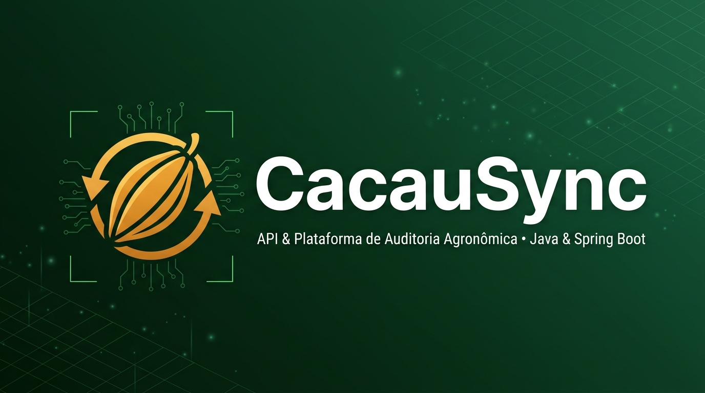

<div align="center">
  
</div>

# 🌱 CacauSync API — Back-end Corporativo para Ensaios Genéticos (CEPEC/CEPLAC)

[](https://openjdk.org)
[](https://spring.io/projects/spring-boot)
[](https://react.dev)
[](https://www.postgresql.org)
[](https://flywaydb.org)
[](https://www.docker.com)
[](https://junit.org)

API RESTful corporativa desenvolvida em **Java 21 + Spring Boot 3.3** para orquestração de rotas de campo, sincronização *offline-first* idempotente de coletas fenotípicas, auditoria fitossanitária com caixas YOLO e análise estatística de produtividade por clone de cacaueiro no contexto do **Centro de Pesquisas do Cacau (CEPEC/CEPLAC)**.

> 📱 **Ecossistema Integrado:** Este back-end atua em conjunto com o aplicativo Android de Visão Computacional Offline ([**CacauApp**](https://github.com/Igor8818/CacauApp)), que utiliza **TensorFlow Lite (YOLOv8 / Object Detection)** em campo (sem conectividade de internet) para contagem de frutos na planta e exportação padronizada em CSV e JSON.

---

## 🎯 Fluxo Operacional em 3 Passos (Pesquisador ↔ Trabalhador de Campo)

Em quadras experimentais de melhoramento genético de cacau (como o ensaio competitivo **TC-1801**, contendo **940 plantas** e **104 clones**), os pesquisadores e técnicos agrícolas atuam em áreas rurais sem sinal de internet. O **CacauSync** resolve toda a logística entre laboratório e campo em 3 etapas diretas no Painel Web:

1. **Passo 1 — Planejamento de Rota (PC $\rightarrow$ Celular em 1 Clique):**
   * O pesquisador importa a planilha oficial de campo em **Excel (`.xlsx`) ou `.csv`** (ou carrega com 1 clique a planilha completa embutida com as **940 plantas do ensaio `TC-1801`**).
   * Com o celular conectado no cabo USB, o botão **`📲 Enviar Rota para o Celular no Cabo USB`** injeta automaticamente a planilha na aba **Modo Rota** do aplicativo Android (`files/rota_precarregada.json`), numerada na ordem exata de caminhamento (`#1` a `#940`).
2. **Passo 2 — Coleta Offline em Campo & Recebimento em 1 Clique (Celular $\rightarrow$ PC):**
   * O trabalhador percorre a quadra seguindo a ordem da planilha no celular (100% offline), tirando as fotos das árvores com detecção **YOLOv8** ou registrando plantas secas/mortas (`"Não Coletável"`).
   * Ao retornar ao laboratório, basta conectar o cabo USB e clicar em **`🔌 Puxar Fotos e Coletas do Celular via USB (1 Clique)`** no painel web (ou tocar em `"SINCRONIZAR COM PC (1 CLIQUE)"` no app via USB/Wi-Fi). O servidor extrai automaticamente os registros, as caixas auditadas do YOLO e as fotos em alta resolução com **idempotência estrita**.
3. **Passo 3 — Conferência Sequencial de Fotos na Ordem da Planilha (`#1 → #N`):**
   * O painel exibe todas as plantas **ordenadas exatamente pela sequência da planilha (`planta.ordemRota ASC`)**, destacando quais já possuem foto coletada (`📷 Com Foto Auditável`) e quais estão pendentes.
   * No modal interativo de auditoria, o pesquisador navega foto por foto na sequência da planilha (**`⬅ Anterior da Planilha`**, **`Próxima da Planilha ➡`** e **`✅ Aprovar Foto e Ir para a Próxima ➡`**), podendo reclassificar frutos (`Sadio`, `Vassoura de Bruxa`, `Podridão Parda`, `Não Avaliável`), **redimensionar caixas (`−` Diminuir / `+` Aumentar)**, adicionar frutos manualmente ou **excluir marcações (`🗑 Excluir`)**.

---

## 🛠️ Stack Tecnológica & Arquitetura

* **Java 21 + Spring Boot 3.3.5:** Arquitetura limpa em camadas (`Controller` $\rightarrow$ `Service` $\rightarrow$ `Repository` $\rightarrow$ `Entity`), uso de `Java Records` para DTOs imutáveis, leitura nativa de planilhas Excel (**Apache POI `.xlsx`**) e CSV (**RFC 4180**), e tratamento global de exceções no padrão **RFC 7807 (`ProblemDetail`)**.
* **Ponte Automática USB ADB (`UsbAdbSyncService` & `RotaPlanejamentoService`):**
  * Integração direta com o Android Debug Bridge (`adb`) no servidor para envio de rotas ao aparelho (`PC -> Celular`), ativação automática de túnel reverso (`adb reverse tcp:8080 tcp:8080`) e extração em 1 clique de JSONs e fotos (`Celular -> PC`).
* **Banco de Dados Relacional (H2 Persistente em Disco ou PostgreSQL 16 + Flyway):**
  * Hierarquia relacional completa: `Ensaio` $\rightarrow$ `Parcela` $\leftrightarrow$ `Clone` $\rightarrow$ `Planta` (`ordemRota`) $\rightarrow$ `LeituraColeta` $\rightarrow$ `DeteccaoYolo`.
  * **Modo Local Zero-Docker (`profile=local`):** Banco H2 em modo de compatibilidade PostgreSQL salvo em disco (`./storage/db/cacausync_local`), permitindo rodar o sistema completo no notebook do pesquisador sem precisar instalar ou abrir o Docker Desktop.
  * **Modo Containerizado (`default`):** Suporte total a **PostgreSQL 16** com migrations versionadas via **Flyway** (`V1` a `V5`).
* **Segurança & RBAC (Spring Security 6 + Auth0 JWT):**
  * Autenticação *stateless* via Bearer Token JWT com controle de acesso baseado em papéis (`ROLE_COORDENADOR` e `ROLE_PESQUISADOR`).
* **Front-end Moderno em React 18 + TypeScript + Vite + Tailwind CSS (`frontend/`):**
  * **Painel Web do Pesquisador (SPA)** compilado e servido nativamente pelo Spring Boot em `/` (`src/main/resources/static/`), com tela de login dividida institucional, barra de progresso global da rota, *Split-View* de conferência sequencial (`#1 → #N`), **Modo Tela Cheia Imersivo (`F` / `Esc`)** com lupa de zoom até 250%, e auditoria interativa das caixas YOLO em HTML5 Canvas.
  * **Swagger UI (SpringDoc OpenAPI 3)** configurado com botão *Authorize (JWT)*.
* **Qualidade de Código (JUnit 5 + Mockito + AssertJ):**
  * **51 testes automatizados** cobrindo cálculo agronômico CEPEC (`SPEC-003`), concordância contratual com o app mobile (`MobileContractTest`), regras de autorização RBAC, parser CSV RFC 4180, sincronização JSON idempotente, validação geométrica de caixas YOLO e emissão de JWT.

---

## 🚀 Como Executar o Projeto Localmente

### Opção A — Execução Rápida Sem Docker (Recomendada para Uso em Desktop/Laboratório)
Não requer Docker Desktop instalado. Os dados e fotos ficam salvos permanentemente na pasta `./storage/`:

```powershell
mvn spring-boot:run "-Dspring-boot.run.profiles=local"
```

### Opção B — Execução com PostgreSQL via Docker Compose
Se preferir rodar com container PostgreSQL 16 na porta `5432`:

```bash
docker compose up -d
mvn spring-boot:run
```

### Acessar no Navegador
* **Painel Web do Pesquisador (Dashboard React):** [http://localhost:8080](http://localhost:8080)
* **Documentação Interativa (Swagger UI):** [http://localhost:8080/swagger-ui.html](http://localhost:8080/swagger-ui.html)

**Credenciais de Acesso:**
| Perfil | Usuário / E-mail | Senha |
| :--- | :--- | :--- |
| **Pesquisador Sênior (CEPEC)** | `uilson lopes` *(ou `uilson.lopes@ceplac.gov.br`)* | `ceplac123` |
| **Coordenador Genético** | `coordenador@cepec.gov.br` | `cepec123` |
| **Pesquisador de Campo** | `pesquisador@cepec.gov.br` | `cepec123` |

---

## 🧪 Suíte de Testes Automatizados (51 Testes JUnit 5 + Mockito)

```bash
mvn test
```

A suíte de testes cobre:
1. **`MobileContractTest`**: Valida a matriz de integração (`SPEC-000`) garantindo que alterações no back-end nunca quebrem o aplicativo Android.
2. **`EnsaioServiceTest`**: Fórmulas agronômicas do CEPEC (`SPEC-003`), calculando produtividade líquida comercial exclusivamente sobre frutos sadios e taxa de sobrevivência clonal.
3. **`LeituraServiceTest`**: Invariantes fitossanitárias (`Total = Sadios + Vassoura + Podridão + Não Avaliável`) e soberania da validação científica do pesquisador.
4. **`CsvColetaParserTest`**: Leitura dos formatos de CSV exportados pelo app Android, remoção de UTF-8 BOM e campos escapados com vírgula/aspas (RFC 4180).
5. **`ColetaSyncServiceTest`**: Garantia de idempotência no reenvio de planilhas e lotes JSON, conversão automática de `"Não Coletável"` em status `NAO_COLETAVEL` da planta e alerta de geolocalização quando o GPS vem zerado (`0.0, 0.0`).
6. **`FotoStorageServiceTest` & `FotoMatcherTest`**: Armazenamento seguro de fotos, hash SHA-256 e pareamento automático com leituras de campo.
7. **`SecurityRulesIntegrationTest` & `JwtServiceTest`**: Bloqueio de acessos não autorizados, emissão e validação de tokens JWT HMAC256.

---

## 🔒 Segurança em Produção

Para implantação em ambiente produtivo:
* Configure variáveis de ambiente para credenciais de banco (`DB_USER`, `DB_PASSWORD`, `DB_URL`);
* Defina uma chave forte para assinatura dos tokens JWT (`JWT_SECRET` com no mínimo 256 bits);
* Utilize HTTPS com terminação TLS (via Nginx ou Traefik reverse proxy);
* Consulte o arquivo `.env.example` para o template completo de variáveis de ambiente.
