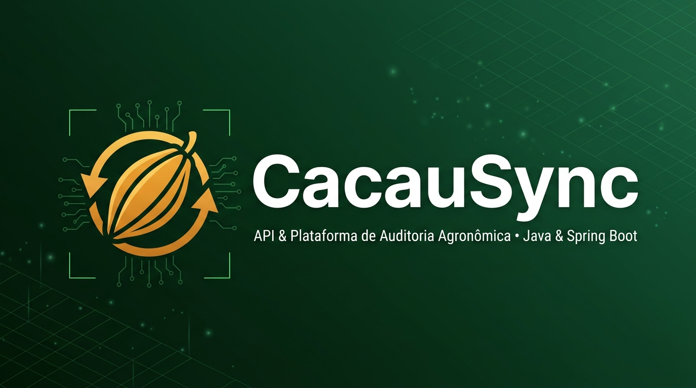
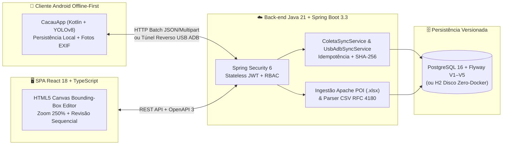

<div align="center">
  
</div>

# ⚡ CacauSync API — Enterprise Back-end (Java 21 + Spring Boot 3) & Painel Web (React 18)

[](https://github.com/Igor8818/CacauSync/actions/workflows/ci.yml)
[](https://openjdk.org)
[](https://spring.io/projects/spring-boot)
[](https://react.dev)
[](https://www.postgresql.org)
[](https://flywaydb.org)
[](https://www.docker.com)
[](https://junit.org)

Plataforma corporativa **Full-Stack** composta por uma **API RESTful em Java 21 + Spring Boot 3.3** e uma **SPA em React 18 + TypeScript**, projetada para **sincronização em lote estritamente idempotente de dispositivos móveis Offline-First**, ingestão nativa de planilhas (`.xlsx` / `.csv`), autenticação *stateless* **JWT com RBAC** e revisão interativa de inferências de Visão Computacional (YOLO) em **HTML5 Canvas**.

> 📱 **Arquitetura Distribuída Offline-First:** Atua como servidor central de sincronização e auditoria para clientes Android de Visão Computacional On-Device ([**CacauApp**](https://github.com/Igor8818/CacauApp)), garantindo integridade transacional, deduplicação por chaves de idempotência e pareamento de imagens via hash `SHA-256` tanto por rede HTTP quanto por ponte automatizada **USB ADB**.

---

## 🏛️ Arquitetura do Sistema



---

## 🎯 Fluxo de Sincronização & Revisão em 3 Etapas

1. **Passo 1 — Ingestão de Planilhas & Provisionamento (PC → Mobile em 1 Clique):**
   * Importação nativa de roteiros operacionais em **Excel (`.xlsx` via Apache POI) ou `.csv` (RFC 4180)**.
   * Via HTTP ou cabo USB (`adb`), o servidor provisiona automaticamente a fila ordenada de trabalho (`files/rota_precarregada.json`) diretamente no armazenamento interno do dispositivo Android.
2. **Passo 2 — Coleta Offline & Sincronização Idempotente em Lote (Mobile → Servidor):**
   * O cliente Android opera 100% sem conectividade executando detecção **YOLOv8** localmente.
   * Ao reconectar via rede Wi-Fi ou ponte **USB ADB em 1 clique**, o back-end processa os lotes JSON, as coordenadas normalizadas das *bounding boxes* e as fotos em alta resolução com **idempotência estrita** (retransmissões não geram duplicatas).
3. **Passo 3 — Auditoria Visual Assistida em HTML5 Canvas (`#1 → #N`):**
   * O painel React 18 lista o progresso da fila sincronizada e oferece um editor **HTML5 Canvas em tela cheia** com zoom de até 250%, permitindo ajustar, reclassificar, redimensionar ou excluir marcações da IA com atalhos de teclado e persistência imediata na API.

---

## 🛠️ Stack Tecnológica & Arquitetura

* **Java 21 + Spring Boot 3.3.5:** Arquitetura limpa em camadas (`Controller` → `Service` → `Repository` → `Entity`), uso de `Java Records` para DTOs imutáveis, leitura nativa de planilhas Excel (**Apache POI `.xlsx`**) e CSV (**RFC 4180**), e tratamento global de exceções no padrão **RFC 7807 (`ProblemDetail`)**.
* **Ponte Automática USB ADB (`UsbAdbSyncService` & `RotaPlanejamentoService`):**
  * Integração direta com o Android Debug Bridge (`adb`) no servidor para envio de rotas ao aparelho (`PC -> Celular`), ativação automática de túnel reverso (`adb reverse tcp:8080 tcp:8080`) e extração em 1 clique de JSONs e fotos (`Celular -> PC`).
* **Banco de Dados Relacional (H2 Persistente em Disco ou PostgreSQL 16 + Flyway):**
  * Hierarquia relacional completa: `Ensaio` → `Parcela` ↔ `Clone` → `Planta` (`ordemRota`) → `LeituraColeta` → `DeteccaoYolo`.
  * **Modo Local Zero-Docker (`profile=local`):** Banco H2 em modo de compatibilidade PostgreSQL salvo em disco (`./storage/db/cacausync_local`), permitindo rodar o sistema completo no notebook do pesquisador sem precisar instalar ou abrir o Docker Desktop.
  * **Modo Containerizado (`default`):** Suporte total a **PostgreSQL 16** com migrations versionadas via **Flyway** (`V1` a `V5`).
* **Segurança & RBAC (Spring Security 6 + Auth0 JWT):**
  * Autenticação *stateless* via Bearer Token JWT com controle de acesso baseado em papéis (`ROLE_COORDENADOR` e `ROLE_PESQUISADOR`).
* **Front-end Moderno em React 18 + TypeScript + Vite + Tailwind CSS (`frontend/`):**
  * **Painel Web do Pesquisador (SPA)** compilado e servido nativamente pelo Spring Boot em `/` (`src/main/resources/static/`), com tela de login dividida institucional, barra de progresso global da rota, *Split-View* de conferência sequencial (`#1 → #N`), **Modo Tela Cheia Imersivo (`F` / `Esc`)** com lupa de zoom até 250%, e auditoria interativa das caixas YOLO em HTML5 Canvas.
  * **Swagger UI (SpringDoc OpenAPI 3)** configurado com botão *Authorize (JWT)*.
* **Qualidade de Código (JUnit 5 + Mockito + AssertJ):**
  * **51 testes automatizados** cobrindo cálculo agronômico CEPEC (`SPEC-003`), concordância contratual com o app mobile (`MobileContractTest`), regras de autorização RBAC, parser CSV RFC 4180, sincronização JSON idempotente, validação geométrica de caixas YOLO e emissão de JWT.

---

## 🚀 Como Executar o Projeto Localmente

### Opção A — Execução Rápida Sem Docker (Recomendada para Uso em Desktop/Laboratório)
Não requer Docker Desktop instalado. Os dados e fotos ficam salvos permanentemente na pasta `./storage/`:

```powershell
mvn spring-boot:run "-Dspring-boot.run.profiles=local"
```

### Opção B — Execução com PostgreSQL via Docker Compose
Se preferir rodar com container PostgreSQL 16 na porta `5432`:

```bash
docker compose up -d
mvn spring-boot:run
```

### Acessar no Navegador
* **Painel Web do Pesquisador (Dashboard React):** [http://localhost:8080](http://localhost:8080)
* **Documentação Interativa (Swagger UI):** [http://localhost:8080/swagger-ui.html](http://localhost:8080/swagger-ui.html)

**Credenciais de Demonstração (Seed Local — `profile=local`):**
| Perfil | E-mail (Ambiente Local) | Senha Local |
| :--- | :--- | :--- |
| **Coordenador Genético** | `coordenador@cepec.gov.br` | `cepec123` |
| **Pesquisador de Campo** | `pesquisador@cepec.gov.br` | `cepec123` |

> *Nota: Contas fictícias pré-carregadas exclusivamente para testes locais em bancada/desenvolvimento.*

---

## 🧪 Suíte de Testes Automatizados (51 Testes JUnit 5 + Mockito)

```bash
mvn test
```

A suíte de testes cobre:
1. **`MobileContractTest`**: Valida a matriz de integração (`SPEC-000`) garantindo que alterações no back-end nunca quebrem o aplicativo Android.
2. **`EnsaioServiceTest`**: Fórmulas agronômicas do CEPEC (`SPEC-003`), calculando produtividade líquida comercial exclusivamente sobre frutos sadios e taxa de sobrevivência clonal.
3. **`LeituraServiceTest`**: Invariantes fitossanitárias (`Total = Sadios + Vassoura + Podridão + Não Avaliável`) e soberania da validação científica do pesquisador.
4. **`CsvColetaParserTest`**: Leitura dos formatos de CSV exportados pelo app Android, remoção de UTF-8 BOM e campos escapados com vírgula/aspas (RFC 4180).
5. **`ColetaSyncServiceTest`**: Garantia de idempotência no reenvio de planilhas e lotes JSON, conversão automática de `"Não Coletável"` em status `NAO_COLETAVEL` da planta e alerta de geolocalização quando o GPS vem zerado (`0.0, 0.0`).
6. **`FotoStorageServiceTest` & `FotoMatcherTest`**: Armazenamento seguro de fotos, hash SHA-256 e pareamento automático com leituras de campo.
7. **`SecurityRulesIntegrationTest` & `JwtServiceTest`**: Bloqueio de acessos não autorizados, emissão e validação de tokens JWT HMAC256.

---

## 🔒 Segurança em Produção

Para implantação em ambiente produtivo:
* Configure variáveis de ambiente para credenciais de banco (`DB_USER`, `DB_PASSWORD`, `DB_URL`);
* Defina uma chave forte para assinatura dos tokens JWT (`JWT_SECRET` com no mínimo 256 bits);
* Utilize HTTPS com terminação TLS (via Nginx ou Traefik reverse proxy);
* Consulte o arquivo `.env.example` para o template completo de variáveis de ambiente.
